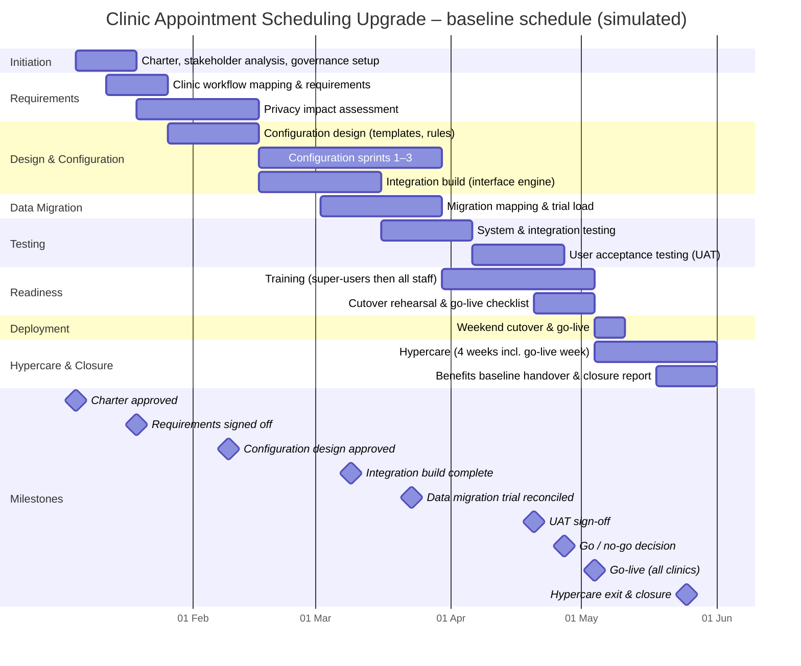

# Schedule and WBS – Clinic Appointment Scheduling Upgrade

> **Simulated project.** Organisation, people and data are fictional and based on a PM Project Lab practice brief. The PM artefacts are my own work, produced to practise real project-management delivery.

## Work breakdown structure
- **1. Initiation**
  - 1.1 Charter, stakeholder analysis, governance setup
- **2. Requirements**
  - 2.1 Clinic workflow mapping & requirements
  - 2.2 Privacy impact assessment
- **3. Design & Configuration**
  - 3.1 Configuration design (templates, rules)
  - 3.2 Configuration sprints 1–3
  - 3.3 Integration build (interface engine)
- **4. Data Migration**
  - 4.1 Migration mapping & trial load
- **5. Testing**
  - 5.1 System & integration testing
  - 5.2 User acceptance testing (UAT)
- **6. Readiness**
  - 6.1 Training (super-users then all staff)
  - 6.2 Cutover rehearsal & go-live checklist
- **7. Deployment**
  - 7.1 Weekend cutover & go-live
- **8. Hypercare & Closure**
  - 8.1 Hypercare (4 weeks incl. go-live week)
  - 8.2 Benefits baseline handover & closure report

## Baseline schedule (Gantt)

## Schedule table
| WBS ID | Phase | Work package | Start week | End week | Duration (weeks) | Start | Finish | Owner |
|---|---|---|---|---|---|---|---|---|
| 1 | Initiation | Charter, stakeholder analysis, governance setup | 1 | 2 | 2 | 05 Jan 2026 | 16 Jan 2026 | PM |
| 2 | Requirements | Clinic workflow mapping & requirements | 2 | 3 | 2 | 12 Jan 2026 | 23 Jan 2026 | Clinical Lead |
| 3 | Requirements | Privacy impact assessment | 3 | 6 | 4 | 19 Jan 2026 | 13 Feb 2026 | Privacy Officer |
| 4 | Design & Configuration | Configuration design (templates, rules) | 4 | 6 | 3 | 26 Jan 2026 | 13 Feb 2026 | Vendor |
| 5 | Design & Configuration | Configuration sprints 1–3 | 7 | 12 | 6 | 16 Feb 2026 | 27 Mar 2026 | Vendor |
| 6 | Design & Configuration | Integration build (interface engine) | 7 | 10 | 4 | 16 Feb 2026 | 13 Mar 2026 | IT Lead |
| 7 | Data Migration | Migration mapping & trial load | 9 | 12 | 4 | 02 Mar 2026 | 27 Mar 2026 | IT Lead |
| 8 | Testing | System & integration testing | 11 | 13 | 3 | 16 Mar 2026 | 03 Apr 2026 | IT Lead |
| 9 | Testing | User acceptance testing (UAT) | 14 | 16 | 3 | 06 Apr 2026 | 24 Apr 2026 | Clinical Lead |
| 10 | Readiness | Training (super-users then all staff) | 13 | 17 | 5 | 30 Mar 2026 | 01 May 2026 | Booking Lead |
| 11 | Readiness | Cutover rehearsal & go-live checklist | 16 | 17 | 2 | 20 Apr 2026 | 01 May 2026 | PM |
| 12 | Deployment | Weekend cutover & go-live | 18 | 18 | 1 | 04 May 2026 | 08 May 2026 | PM |
| 13 | Hypercare & Closure | Hypercare (4 weeks incl. go-live week) | 18 | 21 | 4 | 04 May 2026 | 29 May 2026 | IT Lead |
| 14 | Hypercare & Closure | Benefits baseline handover & closure report | 20 | 21 | 2 | 18 May 2026 | 29 May 2026 | PM |

## Critical path and dependencies
- Requirements sign-off → configuration design → integration build → system testing → UAT → go/no-go → cutover.
- **External dependency:** the interface engine team (outside the core team) controls the integration build; tracked as D-01.
- Privacy impact assessment must be approved before reminder service goes live (D-02).
- 1 week of schedule contingency held between UAT sign-off (Week 16) and go/no-go (Week 17).
