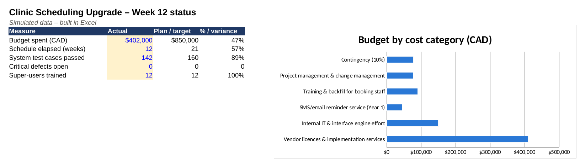

# Clinic Appointment Scheduling Upgrade

**Healthcare · Hybrid (Waterfall governance + Agile configuration sprints) · 21 weeks · Team of 13 · Budget CAD $850K (assumed)**

> **Simulated project.** Organisation, people and data are fictional and based on a PM Project Lab practice brief. The PM artefacts are my own work, produced to practise real project-management delivery.

## The situation
Riverbend's outpatient clinics book appointments in an ageing scheduling system that can no longer handle the volume or the controls the hospital needs. Booking staff phone patients by hand to remind them, double bookings happen every week, and managers have no reliable view of no-shows or clinic utilisation. The hospital must replace the system **without interrupting patient bookings**, test it properly before use, and support staff through hypercare.

## My role
I acted as **Project Manager**: I owned the plan, governance and stakeholder alignment across clinical, IT, booking office and the software vendor; ran the RAID log and weekly status; led UAT and go-live readiness; and managed the vendor's missed integration milestone through formal change control.

## What I delivered
| Artefact | File |
|---|---|
| Project charter | [01-project-charter.md](01-project-charter.md) |
| Stakeholder register & RACI | [02-stakeholders-and-raci.md](02-stakeholders-and-raci.md) |
| WBS, Gantt schedule & critical path | [03-schedule-and-wbs.md](03-schedule-and-wbs.md) |
| RAID log (risks, assumptions, issues, dependencies) | [04-raid-log.md](04-raid-log.md) |
| Communication & status-reporting plan | [05-communication-plan.md](05-communication-plan.md) |
| Prioritised scope backlog with acceptance criteria | [06-scope-backlog.md](06-scope-backlog.md) |
| Release plan, UAT, go-live checklist & hypercare plan | [06-release-uat-golive-hypercare.md](06-release-uat-golive-hypercare.md) |
| Executive status report | [07-status-report.md](07-status-report.md) |
| Decision log & change request | [08-decision-and-change-log.md](08-decision-and-change-log.md) |
| Lessons learned & closure | [09-lessons-learned-and-closure.md](09-lessons-learned-and-closure.md) |

## PM tool files
| Tool | File | What it contains |
|---|---|---|
| Microsoft Excel | [`healthcare-clinic-scheduling-pm-workbook.xlsx`](healthcare-clinic-scheduling-pm-workbook.xlsx) | Gantt chart, stakeholder register, RACI, RAID log (auto-scored), budget, comms plan and a dashboard with live formulas and charts |
| Microsoft Project | [`healthcare-clinic-scheduling-schedule-msproject.xml`](healthcare-clinic-scheduling-schedule-msproject.xml) | Baseline schedule with phases, work packages, owners and milestones (File → Open in MS Project, or open in the free ProjectLibre) |
| Jira | [`jira-import-backlog.csv`](jira-import-backlog.csv) | Backlog ready for Jira CSV import (stories, priority, points, acceptance criteria) |

Data files (open as tables on GitHub, or import into Notion): [`stakeholder-register.csv`](stakeholder-register.csv), [`raci-matrix.csv`](raci-matrix.csv), [`schedule-wbs.csv`](schedule-wbs.csv), [`raid-log.csv`](raid-log.csv), [`scope-backlog.csv`](scope-backlog.csv)

## Key PM decision
When the vendor missed the integration milestone and promised a 1-week recovery, I asked for test results instead of a percentage. Only 11 of 24 interfaces were passing. I re-planned to an evidence-based date, used the schedule contingency, and got sponsor approval for a 1-week go-live move at no extra cost (CR-03), without cutting patient-safety testing.

## Skills demonstrated
Project charter & scope definition, Stakeholder & RACI management, Hybrid delivery, Vendor management, Risk & dependency management, Change control, UAT & go-live readiness, Hypercare planning, Healthcare privacy awareness, Benefits tracking

## Tools
Microsoft Project / Excel (schedule), Jira (backlog & defects; import file included), Microsoft Teams & SharePoint, Mermaid (Gantt)

## How I describe this on my resume
- Planned a simulated 21-week, CAD $850K clinic scheduling upgrade for a 200-bed hospital (6 clinics): charter, RACI, WBS, RAID log, UAT plan and go-live/hypercare plan.
- Managed a vendor milestone slip by replacing a '% complete' claim with test evidence (11 of 24 interfaces passing), re-baselining go-live by 1 week at no extra cost through formal change control.
- Designed a MoSCoW backlog and readiness plan targeting 100% automated reminders and a no-show reduction from 18% to 12% (simulated baseline and target).

## Connection to my real experience
This mirrors my real coordination work on a care-improvement project at Guy's and St Thomas' NHS Foundation Trust, where the goals included fewer missed appointments. There I also built Excel dashboards for management and coordinated clinical, administrative and project stakeholders.

---
Source brief: PM Project Lab, Project 0153 – Clinic Appointment Scheduling Upgrade. Budget rescaled from the brief's indicative figure to a realistic size for the scope.
