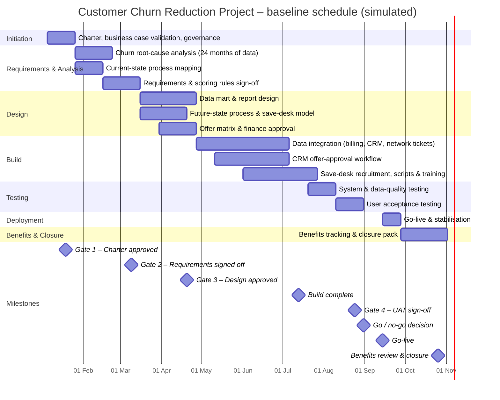

# Schedule and WBS – Customer Churn Reduction Project

> **Simulated project.** Organisation, people and data are fictional and based on a PM Project Lab practice brief. The PM artefacts are my own work, produced to practise real project-management delivery.

## Work breakdown structure
- **1. Initiation**
  - 1.1 Charter, business case validation, governance
- **2. Requirements & Analysis**
  - 2.1 Churn root-cause analysis (24 months of data)
  - 2.2 Current-state process mapping
  - 2.3 Requirements & scoring rules sign-off
- **3. Design**
  - 3.1 Data mart & report design
  - 3.2 Future-state process & save-desk model
  - 3.3 Offer matrix & finance approval
- **4. Build**
  - 4.1 Data integration (billing, CRM, network tickets)
  - 4.2 CRM offer-approval workflow
  - 4.3 Save-desk recruitment, scripts & training
- **5. Testing**
  - 5.1 System & data-quality testing
  - 5.2 User acceptance testing
- **6. Deployment**
  - 6.1 Go-live & stabilisation
- **7. Benefits & Closure**
  - 7.1 Benefits tracking & closure pack

## Baseline schedule (Gantt)

## Schedule table
| WBS ID | Phase | Work package | Start week | End week | Duration (weeks) | Start | Finish | Owner |
|---|---|---|---|---|---|---|---|---|
| 1 | Initiation | Charter, business case validation, governance | 1 | 3 | 3 | 05 Jan 2026 | 23 Jan 2026 | PM |
| 2 | Requirements & Analysis | Churn root-cause analysis (24 months of data) | 4 | 7 | 4 | 26 Jan 2026 | 20 Feb 2026 | BI/CRM Lead |
| 3 | Requirements & Analysis | Current-state process mapping | 4 | 6 | 3 | 26 Jan 2026 | 13 Feb 2026 | Business Owner |
| 4 | Requirements & Analysis | Requirements & scoring rules sign-off | 7 | 10 | 4 | 16 Feb 2026 | 13 Mar 2026 | Business Owner |
| 5 | Design | Data mart & report design | 11 | 16 | 6 | 16 Mar 2026 | 24 Apr 2026 | BI/CRM Lead |
| 6 | Design | Future-state process & save-desk model | 11 | 15 | 5 | 16 Mar 2026 | 17 Apr 2026 | Contact Centre |
| 7 | Design | Offer matrix & finance approval | 13 | 16 | 4 | 30 Mar 2026 | 24 Apr 2026 | Finance |
| 8 | Build | Data integration (billing, CRM, network tickets) | 17 | 26 | 10 | 27 Apr 2026 | 03 Jul 2026 | BI/CRM Lead |
| 9 | Build | CRM offer-approval workflow | 19 | 26 | 8 | 11 May 2026 | 03 Jul 2026 | BI/CRM Lead |
| 10 | Build | Save-desk recruitment, scripts & training | 22 | 29 | 8 | 01 Jun 2026 | 24 Jul 2026 | Contact Centre |
| 11 | Testing | System & data-quality testing | 29 | 31 | 3 | 20 Jul 2026 | 07 Aug 2026 | BI/CRM Lead |
| 12 | Testing | User acceptance testing | 32 | 34 | 3 | 10 Aug 2026 | 28 Aug 2026 | Business Owner |
| 13 | Deployment | Go-live & stabilisation | 37 | 38 | 2 | 14 Sep 2026 | 25 Sep 2026 | PM |
| 14 | Benefits & Closure | Benefits tracking & closure pack | 39 | 43 | 5 | 28 Sep 2026 | 30 Oct 2026 | PM |

## Critical path and dependencies
- Requirements → data mart design → data integration → system/data-quality testing → UAT → go-live.
- **Dependency:** network ticket data feed from Network Operations (D-01) – only available during maintenance windows.
- **Dependency:** Finance approval of the offer budget before Gate 3 (D-02).
- 2 weeks of float between UAT sign-off (Week 34) and go-live (Week 37) protected as schedule contingency.
