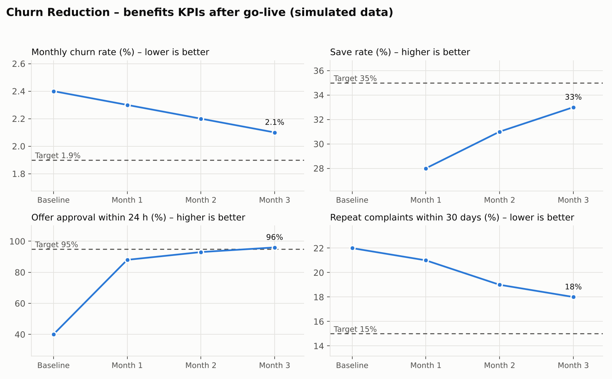

# Benefits / KPI Dashboard – Customer Churn Reduction Project

> **Simulated project.** Organisation, people and data are fictional and based on a PM Project Lab practice brief. The PM artefacts are my own work, produced to practise real project-management delivery.

Data: [`kpi-dashboard.csv`](kpi-dashboard.csv). The chart is generated from the CSV by [`assets/make_chart.py`](assets/make_chart.py).

| KPI | Baseline | Target | Month 3 (simulated) | Trend |
|---|---|---|---|---|
| Monthly churn rate | 2.4% | 1.9% | 2.1% | Improving – on track |
| Save rate | n/a | 35% | 33% | Improving |
| Offer approval within 24 h | ~40% | 95% | 96% | Target met |
| Repeat complaints (30 days) | 22% | 15% | 18% | Improving – behind target |
| Offer cost per save | n/a | ≤ $60 | $57 | Within target |

**Benefit owner after closure:** Ngozi Ibe (Head of Retention). Reviewed monthly at the commercial leadership meeting; 6-month benefits review scheduled.
