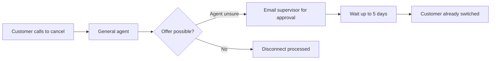
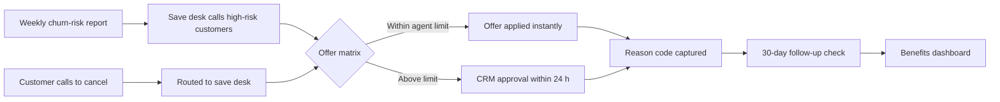

# Current-State / Future-State Process Map – Customer Churn Reduction Project

> **Simulated project.** Organisation, people and data are fictional and based on a PM Project Lab practice brief. The PM artefacts are my own work, produced to practise real project-management delivery.

## Current state – customer wants to cancel

**Pain points:** no early warning; offers need ad-hoc approval (up to 5 days); no record of why customers leave; complaints closed without checking the fix worked.

## Future state – proactive retention

## Controls and handoffs
| Step | Control | Owner |
|---|---|---|
| Risk report | Data-quality checks before release each Monday | BI/CRM Lead |
| Offer | Offer matrix with margin floor; approval limits by role | Finance / Business Owner |
| Reason code | Mandatory field in CRM before case can close | Contact Centre |
| Follow-up | 30-day check that the issue (e.g., outage, billing) is fixed | Contact Centre |
| Outbound contact | Only customers with valid consent flag | Legal |
