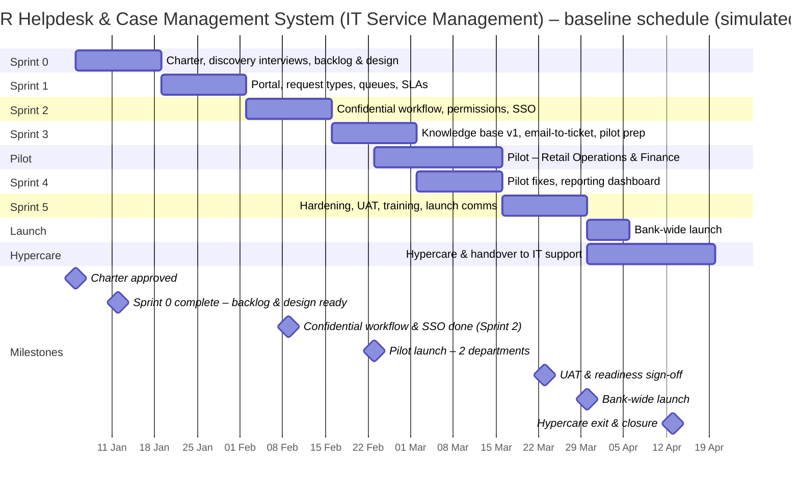

# Schedule and WBS – HR Helpdesk & Case Management System (IT Service Management)

> **Simulated project.** Organisation, people and data are fictional and based on a PM Project Lab practice brief. The PM artefacts are my own work, produced to practise real project-management delivery.

## Work breakdown structure
- **1. Sprint 0**
  - 1.1 Charter, discovery interviews, backlog & design
- **2. Sprint 1**
  - 2.1 Portal, request types, queues, SLAs
- **3. Sprint 2**
  - 3.1 Confidential workflow, permissions, SSO
- **4. Sprint 3**
  - 4.1 Knowledge base v1, email-to-ticket, pilot prep
- **5. Pilot**
  - 5.1 Pilot – Retail Operations & Finance
- **6. Sprint 4**
  - 6.1 Pilot fixes, reporting dashboard
- **7. Sprint 5**
  - 7.1 Hardening, UAT, training, launch comms
- **8. Launch**
  - 8.1 Bank-wide launch
- **9. Hypercare**
  - 9.1 Hypercare & handover to IT support

## Baseline schedule (Gantt)

## Schedule table
| WBS ID | Phase | Work package | Start week | End week | Duration (weeks) | Start | Finish | Owner |
|---|---|---|---|---|---|---|---|---|
| 1 | Sprint 0 | Charter, discovery interviews, backlog & design | 1 | 2 | 2 | 05 Jan 2026 | 16 Jan 2026 | PM |
| 2 | Sprint 1 | Portal, request types, queues, SLAs | 3 | 4 | 2 | 19 Jan 2026 | 30 Jan 2026 | ITSM Lead |
| 3 | Sprint 2 | Confidential workflow, permissions, SSO | 5 | 6 | 2 | 02 Feb 2026 | 13 Feb 2026 | ITSM Lead |
| 4 | Sprint 3 | Knowledge base v1, email-to-ticket, pilot prep | 7 | 8 | 2 | 16 Feb 2026 | 27 Feb 2026 | Product Owner |
| 5 | Pilot | Pilot – Retail Operations & Finance | 8 | 10 | 3 | 23 Feb 2026 | 13 Mar 2026 | HR Ops Lead |
| 6 | Sprint 4 | Pilot fixes, reporting dashboard | 9 | 10 | 2 | 02 Mar 2026 | 13 Mar 2026 | ITSM Lead |
| 7 | Sprint 5 | Hardening, UAT, training, launch comms | 11 | 12 | 2 | 16 Mar 2026 | 27 Mar 2026 | PM |
| 8 | Launch | Bank-wide launch | 13 | 13 | 1 | 30 Mar 2026 | 03 Apr 2026 | PM |
| 9 | Hypercare | Hypercare & handover to IT support | 13 | 15 | 3 | 30 Mar 2026 | 17 Apr 2026 | ITSM Lead |

## Critical path and dependencies
- Sprint 2 confidential workflow + Privacy Officer sign-off **must** finish before the pilot (Week 8).
- **Dependency:** SSO / employee directory integration owned by Identity team (outside core team) – D-01.
- Knowledge-base articles from HR content owners needed by Week 10 for launch (D-02).
- Launch slot avoids month-end payroll week to protect HR capacity.
