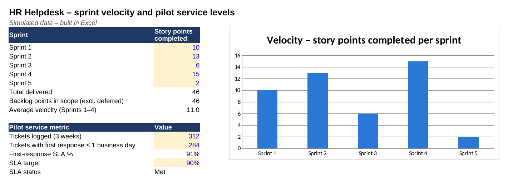

# HR Helpdesk & Case Management System (IT Service Management)

**IT / Service Management (HR technology) · Agile (Scrum – 2-week sprints) · 15 weeks · Team of 8 · Budget CAD $180K (assumed)**

> **Simulated project.** Organisation, people and data are fictional and based on a PM Project Lab practice brief. The PM artefacts are my own work, produced to practise real project-management delivery.

## The situation
Employees send HR questions to individual HR staff by personal email and WhatsApp. Nobody can see how many queries arrive, how long answers take, or which issues keep coming back. Some HR staff like handling 'their' employees personally and are wary of a shared queue. Sensitive cases such as grievances **cannot** sit in the same visible queue as routine requests. The bank wants an HR service portal and case-management system, delivered in Agile sprints.

## My role
I acted as **Project Manager**: I worked as Project Manager / Scrum facilitator with the HR product owner: charter, backlog shaping, sprint cadence, RAID log, launch-readiness and hypercare planning, and change management for HR staff. I also led the response when a confidential case was logged in the general queue during the pilot.

## What I delivered
| Artefact | File |
|---|---|
| Project charter | [01-project-charter.md](01-project-charter.md) |
| Stakeholder register & RACI | [02-stakeholders-and-raci.md](02-stakeholders-and-raci.md) |
| WBS, Gantt schedule & critical path | [03-schedule-and-wbs.md](03-schedule-and-wbs.md) |
| RAID log (risks, assumptions, issues, dependencies) | [04-raid-log.md](04-raid-log.md) |
| Communication & status-reporting plan | [05-communication-plan.md](05-communication-plan.md) |
| Product backlog with acceptance criteria | [06-product-backlog.md](06-product-backlog.md) |
| Release & launch readiness, UAT, go-live checklist & hypercare | [06-release-uat-golive-hypercare.md](06-release-uat-golive-hypercare.md) |
| Executive status report | [07-status-report.md](07-status-report.md) |
| Decision log & change request | [08-decision-and-change-log.md](08-decision-and-change-log.md) |
| Lessons learned & closure | [09-lessons-learned-and-closure.md](09-lessons-learned-and-closure.md) |

## PM tool files
| Tool | File | What it contains |
|---|---|---|
| Microsoft Excel | [`it-hr-helpdesk-service-management-pm-workbook.xlsx`](it-hr-helpdesk-service-management-pm-workbook.xlsx) | Gantt chart, stakeholder register, RACI, RAID log (auto-scored), budget, comms plan and a dashboard with live formulas and charts |
| Microsoft Project | [`it-hr-helpdesk-service-management-schedule-msproject.xml`](it-hr-helpdesk-service-management-schedule-msproject.xml) | Baseline schedule with phases, work packages, owners and milestones (File → Open in MS Project, or open in the free ProjectLibre) |
| Jira | [`jira-import-backlog.csv`](jira-import-backlog.csv) | Backlog ready for Jira CSV import (stories, priority, points, acceptance criteria) |

Data files (open as tables on GitHub, or import into Notion): [`stakeholder-register.csv`](stakeholder-register.csv), [`raci-matrix.csv`](raci-matrix.csv), [`schedule-wbs.csv`](schedule-wbs.csv), [`raid-log.csv`](raid-log.csv), [`product-backlog.csv`](product-backlog.csv)

## Key PM decision
During the pilot, a grievance was logged in the general queue and 6 HR agents could see it. I contained it within 30 minutes, brought in the Privacy Officer and sponsor the same day, and traced the root cause to a confusing request-type label. The fix went into the next sprint: a clear 'confidential concern' option, keyword auto re-routing, and negative permission tests in the Definition of Done.

## Skills demonstrated
Agile / Scrum delivery, Backlog management & user stories, IT service management (ITSM), Privacy-by-design, Incident response, Change management & resistance, UAT & launch readiness, Pilot planning

## Tools
Jira Service Management (backlog import file included), Confluence-style knowledge base, Microsoft Teams & SharePoint, Power Automate (email notifications), Excel (velocity & SLA dashboard), Microsoft Project

## How I describe this on my resume
- Delivered a simulated 15-week, CAD $180K Agile rollout of an HR service portal (Jira Service Management) for a 2,400-employee bank, replacing email/WhatsApp requests with a tracked queue and SLAs.
- Contained a confidential-case privacy incident within 30 minutes, led the root-cause fix (keyword re-routing, permission tests in Definition of Done) with zero further unauthorised views.
- Drove adoption with HR staff through 'preferred adviser' routing, training for 18 agents and a 40-article knowledge base (simulated).

## Connection to my real experience
I have hands-on experience with Jira and Jira Service Management, Microsoft Teams, SharePoint and Power Automate. In my roles I've set up user accounts and access, written user guides, and delivered virtual training and workshops. This project puts those skills into a full IT rollout.

---
Source brief: PM Project Lab, Project 1011 – HR Helpdesk & Case Management System. Budget rescaled from the brief's indicative figure to a realistic size for the scope.
