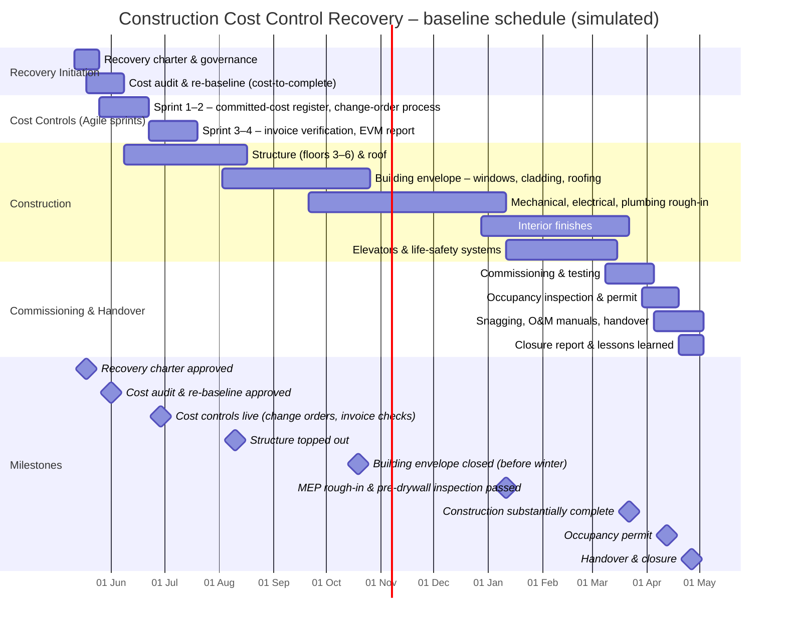

# Schedule and WBS – Construction Cost Control Recovery

> **Simulated project.** Organisation, people and data are fictional and based on a PM Project Lab practice brief. The PM artefacts are my own work, produced to practise real project-management delivery.

## Work breakdown structure
- **1. Recovery Initiation**
  - 1.1 Recovery charter & governance
  - 1.2 Cost audit & re-baseline (cost-to-complete)
- **2. Cost Controls (Agile sprints)**
  - 2.1 Sprint 1–2 – committed-cost register, change-order process
  - 2.2 Sprint 3–4 – invoice verification, EVM report
- **3. Construction**
  - 3.1 Structure (floors 3–6) & roof
  - 3.2 Building envelope – windows, cladding, roofing
  - 3.3 Mechanical, electrical, plumbing rough-in
  - 3.4 Interior finishes
  - 3.5 Elevators & life-safety systems
- **4. Commissioning & Handover**
  - 4.1 Commissioning & testing
  - 4.2 Occupancy inspection & permit
  - 4.3 Snagging, O&M manuals, handover
  - 4.4 Closure report & lessons learned

## Baseline schedule (Gantt)

## Schedule table
| WBS ID | Phase | Work package | Start week | End week | Duration (weeks) | Start | Finish | Owner |
|---|---|---|---|---|---|---|---|---|
| 1 | Recovery Initiation | Recovery charter & governance | 1 | 2 | 2 | 11 May 2026 | 22 May 2026 | PM |
| 2 | Recovery Initiation | Cost audit & re-baseline (cost-to-complete) | 2 | 4 | 3 | 18 May 2026 | 05 Jun 2026 | Cost Consultant |
| 3 | Cost Controls (Agile sprints) | Sprint 1–2 – committed-cost register, change-order process | 3 | 6 | 4 | 25 May 2026 | 19 Jun 2026 | Commercial Mgr |
| 4 | Cost Controls (Agile sprints) | Sprint 3–4 – invoice verification, EVM report | 7 | 10 | 4 | 22 Jun 2026 | 17 Jul 2026 | PM |
| 5 | Construction | Structure (floors 3–6) & roof | 5 | 14 | 10 | 08 Jun 2026 | 14 Aug 2026 | General Contractor |
| 6 | Construction | Building envelope – windows, cladding, roofing | 13 | 24 | 12 | 03 Aug 2026 | 23 Oct 2026 | General Contractor |
| 7 | Construction | Mechanical, electrical, plumbing rough-in | 20 | 35 | 16 | 21 Sep 2026 | 08 Jan 2027 | General Contractor |
| 8 | Construction | Interior finishes | 34 | 45 | 12 | 28 Dec 2026 | 19 Mar 2027 | General Contractor |
| 9 | Construction | Elevators & life-safety systems | 36 | 44 | 9 | 11 Jan 2027 | 12 Mar 2027 | General Contractor |
| 10 | Commissioning & Handover | Commissioning & testing | 44 | 47 | 4 | 08 Mar 2027 | 02 Apr 2027 | Construction Mgr |
| 11 | Commissioning & Handover | Occupancy inspection & permit | 47 | 49 | 3 | 29 Mar 2027 | 16 Apr 2027 | Construction Mgr |
| 12 | Commissioning & Handover | Snagging, O&M manuals, handover | 48 | 51 | 4 | 05 Apr 2027 | 30 Apr 2027 | Ops Lead |
| 13 | Commissioning & Handover | Closure report & lessons learned | 50 | 51 | 2 | 19 Apr 2027 | 30 Apr 2027 | PM |

## Critical path and dependencies
- Structure → **building envelope (windows)** → MEP rough-in → pre-drywall inspection → interiors → commissioning → occupancy permit → handover.
- **Envelope close-in before freeze-up (Week 24)** is the main schedule risk: without it, interior trades need temporary heat and enclosure.
- **External dependencies:** city inspections (D-01), utility power connection (D-02), window supplier production (D-03).
- Schedule contingency: 2 weeks between substantial completion (Week 46) and occupancy inspection.
