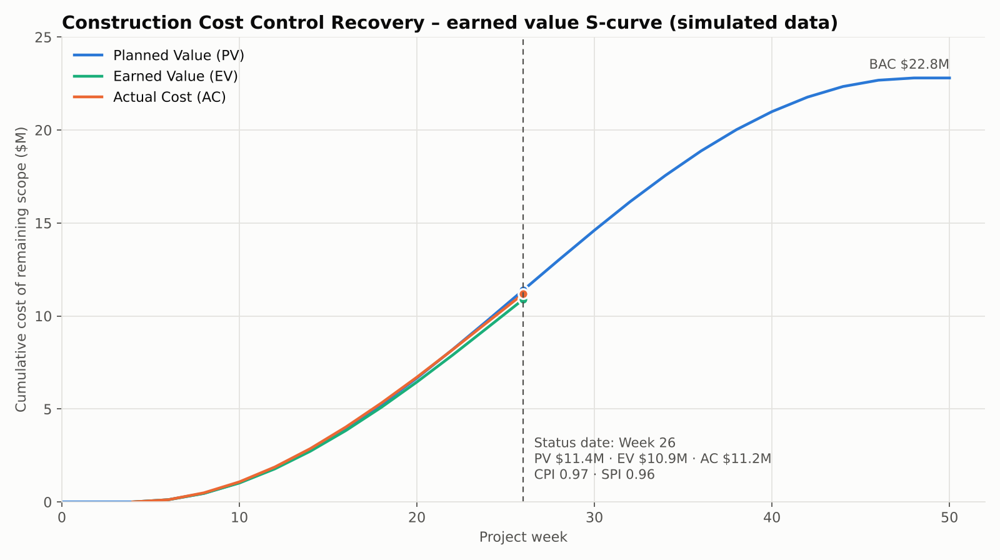

# Construction Cost Control Recovery

**Construction & Real Estate · Hybrid (Waterfall construction schedule + 2-week Agile sprints to build cost controls) · 51 weeks · Team of 14 · Budget CAD $650K (on a $38M build) (assumed)**

> **Simulated project.** Organisation, people and data are fictional and based on a PM Project Lab practice brief. The PM artefacts are my own work, produced to practise real project-management delivery.

## The situation
Lakeline's 96-unit residential build is 40% complete but forecasting a **9% cost overrun**: about $41.4M against a $38M budget. A previous attempt to fix it caused rework because scope, ownership and acceptance criteria were unclear. Change orders are approved verbally, invoices are paid without checking them against site progress, and nobody knows the true committed cost. I was brought in to run a recovery: set up proper cost control and finish the building within an acceptable variance, with governance explicit from day one.

## My role
I acted as **Project Manager**: I re-baselined cost and schedule, set up commitment tracking, change-order control and invoice-to-progress verification, introduced monthly earned-value (EVM) reporting, coordinated the general contractor, cost consultant and suppliers, and managed the window supplier's missed delivery before winter.

## What I delivered
| Artefact | File |
|---|---|
| Project charter | [01-project-charter.md](01-project-charter.md) |
| Stakeholder register & RACI | [02-stakeholders-and-raci.md](02-stakeholders-and-raci.md) |
| WBS, Gantt schedule & critical path | [03-schedule-and-wbs.md](03-schedule-and-wbs.md) |
| RAID log (risks, assumptions, issues, dependencies) | [04-raid-log.md](04-raid-log.md) |
| Communication & status-reporting plan | [05-communication-plan.md](05-communication-plan.md) |
| WBS & site execution plan with inspection points | [06-site-execution-plan.md](06-site-execution-plan.md) |
| Procurement / contractor tracker & quality inspection plan | [06-procurement-quality-tracker.md](06-procurement-quality-tracker.md) |
| Monthly earned-value (EVM) cost report | [06-evm-cost-report.md](06-evm-cost-report.md) |
| Handover, snagging & acceptance checklist | [06-handover-snagging-checklist.md](06-handover-snagging-checklist.md) |
| Executive status report | [07-status-report.md](07-status-report.md) |
| Decision log & change request | [08-decision-and-change-log.md](08-decision-and-change-log.md) |
| Lessons learned & closure | [09-lessons-learned-and-closure.md](09-lessons-learned-and-closure.md) |

Data files (open as tables on GitHub, or import into Notion/Excel): [`stakeholder-register.csv`](stakeholder-register.csv), [`raci-matrix.csv`](raci-matrix.csv), [`schedule-wbs.csv`](schedule-wbs.csv), [`raid-log.csv`](raid-log.csv), [`procurement-contractor-tracker.csv`](procurement-contractor-tracker.csv)

## Key PM decision
When the window supplier said it would be '2 weeks late', I asked for its factory production schedule. That showed 5 weeks, which threatened to leave the building open going into an Edmonton winter. I gave the sponsor three costed options and implemented temporary enclosure and heat for the lower floors. That protected the critical path for $145K, part of it recoverable from the supplier under the contract.

## Skills demonstrated
Cost control & earned value management (EVM), Contract & change-order administration, Contractor and supplier management, Re-baselining, Critical-path & seasonal risk management, Quality inspection planning, Handover & close-out, Lender / stakeholder reporting

## Tools
Excel (cost register, EVM), Python (S-curve chart), Microsoft Project, SharePoint (document control), Mermaid (Gantt)

## How I describe this on my resume
- Led a simulated cost-control recovery on a CAD $38M, 96-unit residential build, cutting forecast overrun from +9% to +2.1% through re-baselining, change-order control and site-verified progress payments.
- Introduced monthly earned-value reporting (CPI 0.97, SPI 0.96 at Month 6) for the sponsor and lender, and priced $1.1M of undocumented verbal change orders (31% rejected or reduced).
- Protected the winter critical path when a window supplier slipped 5 weeks: challenged its 2-week claim with factory evidence and implemented temporary enclosure (+$145K, partly recovered under contract).

## Connection to my real experience
This draws directly on my contract administration work at Rusteve International Limited. I tracked contracts worth over $1M each, checked invoices against contract terms, verified payment milestones against physical progress reports and tracked vendor delivery timelines. I also escalated cost overruns, and the projects passed internal and external audits.

---
Source brief: PM Project Lab, Project 0009 – Construction Cost Control Recovery. Budget rescaled from the brief's indicative figure to a realistic size for the scope.
