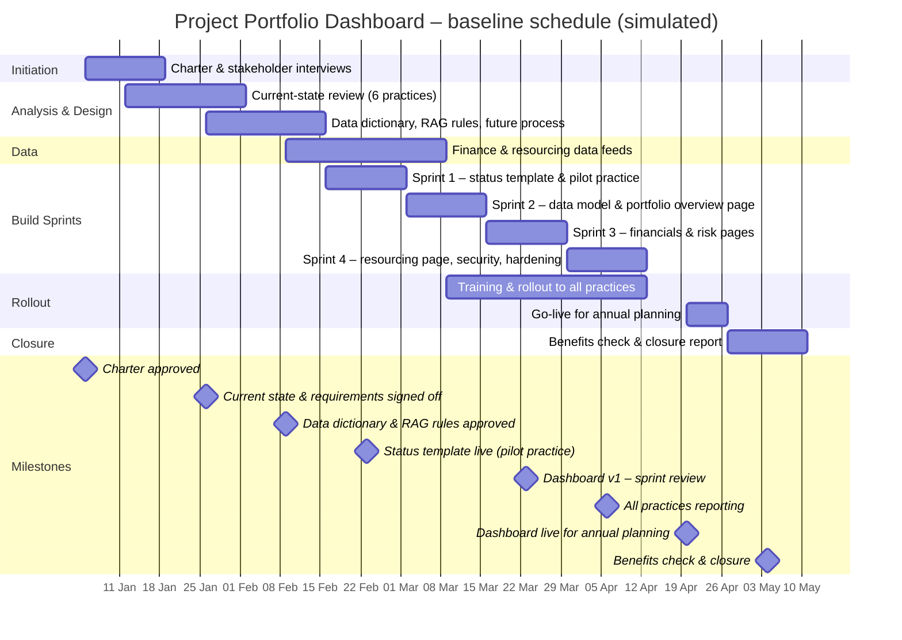

# Schedule and WBS – Project Portfolio Dashboard

> **Simulated project.** Organisation, people and data are fictional and based on a PM Project Lab practice brief. The PM artefacts are my own work, produced to practise real project-management delivery.

## Work breakdown structure
- **1. Initiation**
  - 1.1 Charter & stakeholder interviews
- **2. Analysis & Design**
  - 2.1 Current-state review (6 practices)
  - 2.2 Data dictionary, RAG rules, future process
- **3. Data**
  - 3.1 Finance & resourcing data feeds
- **4. Build Sprints**
  - 4.1 Sprint 1 – status template & pilot practice
  - 4.2 Sprint 2 – data model & portfolio overview page
  - 4.3 Sprint 3 – financials & risk pages
  - 4.4 Sprint 4 – resourcing page, security, hardening
- **5. Rollout**
  - 5.1 Training & rollout to all practices
  - 5.2 Go-live for annual planning
- **6. Closure**
  - 6.1 Benefits check & closure report

## Baseline schedule (Gantt)

## Schedule table
| WBS ID | Phase | Work package | Start week | End week | Duration (weeks) | Start | Finish | Owner |
|---|---|---|---|---|---|---|---|---|
| 1 | Initiation | Charter & stakeholder interviews | 1 | 2 | 2 | 05 Jan 2026 | 16 Jan 2026 | PM |
| 2 | Analysis & Design | Current-state review (6 practices) | 2 | 4 | 3 | 12 Jan 2026 | 30 Jan 2026 | Head of PMO |
| 3 | Analysis & Design | Data dictionary, RAG rules, future process | 4 | 6 | 3 | 26 Jan 2026 | 13 Feb 2026 | Head of PMO |
| 4 | Data | Finance & resourcing data feeds | 6 | 9 | 4 | 09 Feb 2026 | 06 Mar 2026 | BI Lead |
| 5 | Build Sprints | Sprint 1 – status template & pilot practice | 7 | 8 | 2 | 16 Feb 2026 | 27 Feb 2026 | Delivery Ops |
| 6 | Build Sprints | Sprint 2 – data model & portfolio overview page | 9 | 10 | 2 | 02 Mar 2026 | 13 Mar 2026 | BI Lead |
| 7 | Build Sprints | Sprint 3 – financials & risk pages | 11 | 12 | 2 | 16 Mar 2026 | 27 Mar 2026 | BI Lead |
| 8 | Build Sprints | Sprint 4 – resourcing page, security, hardening | 13 | 14 | 2 | 30 Mar 2026 | 10 Apr 2026 | BI Lead |
| 9 | Rollout | Training & rollout to all practices | 10 | 14 | 5 | 09 Mar 2026 | 10 Apr 2026 | Delivery Ops |
| 10 | Rollout | Go-live for annual planning | 16 | 16 | 1 | 20 Apr 2026 | 24 Apr 2026 | PM |
| 11 | Closure | Benefits check & closure report | 17 | 18 | 2 | 27 Apr 2026 | 08 May 2026 | PM |

## Critical path and dependencies
- RAG rules sign-off → finance data feed → data model → dashboard sprints → go-live for annual planning (fixed date, Week 16).
- **Dependency:** finance weekly export (D-01) – owned outside the core team.
- **Constraint:** PM and partner availability (billable work) – training kept to 30-minute sessions.
- 1 week of float between Sprint 4 (Week 14) and go-live (Week 16).
