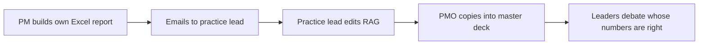
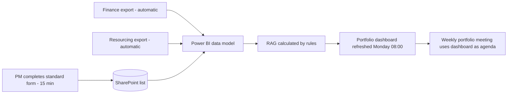

# Current-State / Future-State Reporting Process – Project Portfolio Dashboard

> **Simulated project.** Organisation, people and data are fictional and based on a PM Project Lab practice brief. The PM artefacts are my own work, produced to practise real project-management delivery.

## Current state

**Pain points:** 6 different templates; RAG based on opinion; finance figures re-keyed by hand; about 3 hours per PM per week; reports are already a week old by the meeting.

## Future state

## Controls and handoffs
| Control | Owner |
|---|---|
| Submission deadline Friday 15:00; missing reports shown on dashboard | Delivery Ops |
| Finance reconciliation check before refresh | BI Lead |
| RAG override only with written reason (logged) | Head of PMO |
| Row-level security by practice | BI Lead |
