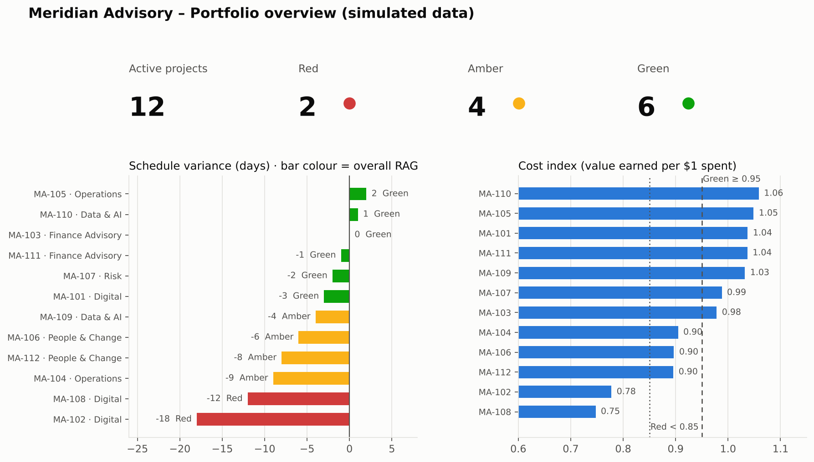

# Project Portfolio Dashboard

**General / cross-industry (Professional Services & PMO) · Hybrid (Waterfall for data & governance, Agile sprints for dashboard build) · 18 weeks · Team of 9 · Budget CAD $150K (assumed)**

> **Simulated project.** Organisation, people and data are fictional and based on a PM Project Lab practice brief. The PM artefacts are my own work, produced to practise real project-management delivery.

## The situation
Meridian's project managers report status in their own Excel formats. Leadership spends the first hour of every portfolio meeting arguing about whose numbers are right, and nobody can see at a glance which client projects are at risk, over budget or short of staff. The firm wants one **standard status process and a portfolio dashboard** before its annual planning cycle, a hard date, without taking billable consultants off client work.

## My role
I acted as **Project Manager**: I led the project end to end: charter, stakeholder alignment across 6 practices, the current/future reporting process, data and RAG standards, sprint planning with the BI developer, adoption, benefits tracking, and governing a late change request from a senior partner.

## What I delivered
| Artefact | File |
|---|---|
| Project charter | [01-project-charter.md](01-project-charter.md) |
| Stakeholder register & RACI | [02-stakeholders-and-raci.md](02-stakeholders-and-raci.md) |
| WBS, Gantt schedule & critical path | [03-schedule-and-wbs.md](03-schedule-and-wbs.md) |
| RAID log (risks, assumptions, issues, dependencies) | [04-raid-log.md](04-raid-log.md) |
| Communication & status-reporting plan | [05-communication-plan.md](05-communication-plan.md) |
| Current-state / future-state reporting process | [06-process-map-current-future.md](06-process-map-current-future.md) |
| Data dictionary & RAG rules | [06-data-dictionary-rag-rules.md](06-data-dictionary-rag-rules.md) |
| Implementation plan with owners & acceptance criteria | [06-implementation-plan.md](06-implementation-plan.md) |
| Benefits / KPI dashboard (with sample portfolio data) | [06-benefits-kpi-dashboard.md](06-benefits-kpi-dashboard.md) |
| Executive status report | [07-status-report.md](07-status-report.md) |
| Decision log & change request | [08-decision-and-change-log.md](08-decision-and-change-log.md) |
| Lessons learned & closure | [09-lessons-learned-and-closure.md](09-lessons-learned-and-closure.md) |

Data files (open as tables on GitHub, or import into Notion/Excel): [`stakeholder-register.csv`](stakeholder-register.csv), [`raci-matrix.csv`](raci-matrix.csv), [`schedule-wbs.csv`](schedule-wbs.csv), [`raid-log.csv`](raid-log.csv), [`portfolio-data.csv`](portfolio-data.csv), [`kpi-dashboard.csv`](kpi-dashboard.csv)

## Key PM decision
At Week 12 a senior partner asked to 'just add' a consultant-level utilisation page. I showed the impact in numbers: +3 weeks past a fixed date, +$22K against $14K of contingency, and a privacy review. I offered a practice-level view in the current sprint and a Phase 2 backlog item. The partner agreed and go-live stayed on date.

## Skills demonstrated
PMO & portfolio reporting, Data governance (data dictionary, RAG rules), Dashboard requirements & KPI design, Hybrid delivery, Scope & change control, Stakeholder management (senior partners), Change management & adoption, Benefits realisation

## Tools
Power BI / IBM Cognos (dashboard), Excel, Python (pandas, matplotlib), SharePoint lists & Microsoft Forms, Power Automate, Mermaid

## How I describe this on my resume
- Delivered a simulated 18-week, CAD $150K portfolio-reporting project for a 40-project consulting firm: standard status template, rule-based RAG and a Power BI dashboard live before the annual planning deadline.
- Defined the data dictionary and RAG rules agreed by 6 practice leads, ending reporting disputes; targets: 100% template adoption and PM reporting time from ~3 h to under 1 h (simulated).
- Assessed a late senior-partner change request (+3 weeks, +$22K, privacy risk) and steered it to a Phase 2 backlog with an interim solution, protecting the fixed go-live date.

## Connection to my real experience
This combines my PMP training with my NPower Canada AI & Data Analytics program and IBM Data Analyst work (Excel, Python, dashboards). It also builds on my real experience creating Excel dashboards and reports for management decision-making in my NHS role.

---
Source brief: PM Project Lab, Project 0912 – Project Portfolio Dashboard. Budget rescaled from the brief's indicative figure to a realistic size for the scope.
